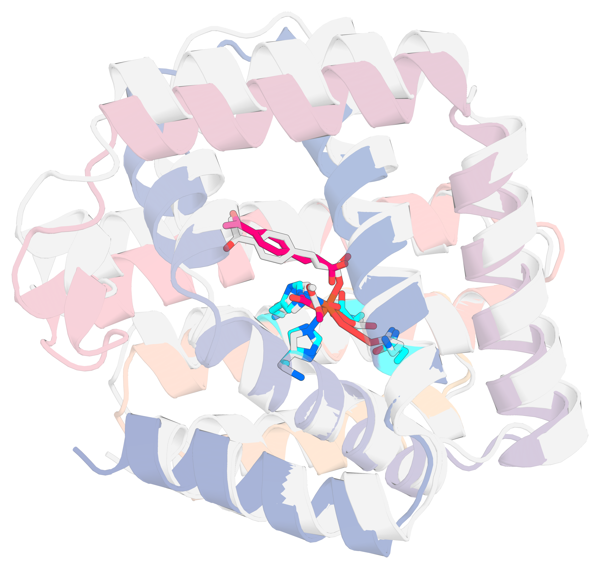

# CaGE: conditioned all-atom structure generation with catalytic guidance

CaGE adds **five atom-level design conditions** to the [RF3](https://doi.org/10.1101/2025.08.14.670328)
all-atom structure prediction network, trains them jointly with the structure objective,
and exposes **classifier-free guidance (CFG) over each condition axis separately** at
inference time. It also ships **motif guidance**, an untrained sampler-side projection that
holds a reference motif rigid during denoising.

<div align="center">
  
</div>

## What this adds

- **Five design conditions**, injected during training and requestable per atom at
  inference: interface hotspots, interface type, relative solvent accessibility,
  hydrogen-bond donor/acceptor identity, and atom-pair distances. They are conditions,
  not constraints — the model was trained to respect them.
- **Per-axis classifier-free guidance.** Guide one condition at a time
  (`inference_cfg_scale={distance_template: 3.0}`) or everything at once, over eight
  guidable axes: the five design conditions plus RF3's template, relative-template and
  ground-truth-conformer tracks. Scale `0` is a well-defined zero point for an axis;
  scale `1` is the conditional prediction with no extrapolation.
- **Noise-interval gating.** Apply guidance only where it helps, over a chosen band of
  the diffusion noise schedule (`inference_cfg_sigma_min` / `inference_cfg_sigma_max`).
- **Per-stream confidence.** Score the unconditional stream, each guidance stream, and the
  CFG-extrapolated "merged" stream with the confidence head. Select the scoring and ranking
  streams with `confidence_streams` and `ranking_stream`.
- **Motif guidance.** During active diffusion steps, the sampler Kabsch-fits a reference
  motif onto the prediction and projects the motif atoms toward it. Use it with a backbone
  template and at least three non-collinear anchors per group. See
  [docs/DESIGN_CONDITIONS.md](docs/DESIGN_CONDITIONS.md#10-motif-guidance-motif_guidance_selection)
  for the controls and activation criteria.

## Getting started

Download the model weights from [Zenodo](https://doi.org/10.5281/zenodo.23460926)
with `foundry install run14_confhead`. See [docs/WEIGHTS.md](docs/WEIGHTS.md) for
checkpoint details, direct download links and checksums.

```bash
# install (see docs/INSTALL.md for the pip route, env vars and GPU notes)
uv venv --python 3.12 && source .venv/bin/activate
uv pip install -e ".[rf3]"

# download the default checkpoint
foundry install run14_confhead

# a first prediction
rf3 fold inputs='models/rf3/tests/data/5vht_from_json.json'

# a first design condition
rf3 fold inputs='docs/releases/rf3/examples/design_conditions/hotspot/ppi_hotspot_7xli.json'
```

Run `rf3 fold` from the repository root: the bundled example inputs use
repository-relative paths.

For repeatable comparisons, explicitly add `model_seeds='[0]'` to each `rf3 fold`
command (or choose another seed list), and keep `diffusion_batch_size` fixed.
The input JSON's `"seed"` field is ignored; use the `model_seeds` argument. See
[the model control arguments](models/rf3/README.md#command-line-arguments).

- **[docs/INSTALL.md](docs/INSTALL.md)** — installation, environment variables, optional
  external tools, GPU notes.
- **[docs/WEIGHTS.md](docs/WEIGHTS.md)** — downloads, checkpoint details,
  and which one you need for per-stream confidence.
- **[models/rf3/README.md](models/rf3/README.md)** — the full inference API: input
  formats, MSAs, ligands, templating, every command-line argument.

## The five design conditions

| Condition | Field | Value | Training rate |
|---|---|---|---|
| Interface hotspots | `hotspot_selection` | atom selections | 15 % |
| Interface type | `interface_type` | `PPI` / `PLI` / `PNA`, or per-selection labels | 15 % |
| Relative solvent accessibility | `rasa_selection` | selections (auto-binned) or `BURIED` / `INTERMEDIATE` / `EXPOSED` | 2.4 % |
| H-bond donor / acceptor | `hbond_selection` | `{selection: DONOR / ACCEPTOR}` | 0.4 % |
| Atom-pair distances | `distance_template_selection` | atom groups, optionally with distances in Å | 4 % |

Rates are the effective per-example rates of the training recipe. RASA was trained
on ligand atoms, interface type is supplied with hotspots during training, and the
distance condition atomizes the residues it selects.

See [docs/DESIGN_CONDITIONS.md](docs/DESIGN_CONDITIONS.md) for JSON and CLI forms,
accepted values, features, metrics and guidance settings.

## Examples

Runnable inputs for every condition, built only from structures that ship with this
repository, are indexed in
**[docs/releases/rf3/examples/design_conditions/README.md](docs/releases/rf3/examples/design_conditions/README.md)**,
with CFG command lines alongside. The non-conditioned examples (MSAs, ligands, covalent
modifications, templating) live one directory up in
[docs/releases/rf3/examples/](docs/releases/rf3/examples/).

## Reproducing the paper

- **Training recipes.** `models/rf3/configs/experiment/rf3_run14.yaml` is the base recipe;
  `rf3_run14_invfold.yaml` is the one the released weights were trained with (it overrides
  the hotspot loss weights to `0.0`, so hotspots act purely as an input condition).
  `models/rf3/configs/design_tasks/all.yaml` holds the design-task frequencies, annotated
  with the effective per-condition rates.
- **Design validation.** `models/rf3/configs/experiment/rf3_run14_design_validation_only.yaml`
  runs the condition-adherence metrics (RASA, hotspot contact, h-bond, motif/distance).
- **Figures.** `dump_trajectories=true` writes per-step `x_t`, `x0` and per-stream CFG
  estimates; `models/rf3/scripts/render_diffusion_trajectory.py` and
  `models/rf3/scripts/layout_trajectory_panel.py` turn those into the guidance mechanism
  panels.
- **Data and tools.** Supply your own training and validation datasets. H-bond
  training and metrics use HBPLUS. See
  [docs/DESIGN_CONDITIONS.md](docs/DESIGN_CONDITIONS.md#11-metrics-and-training-dependencies)
  for metric inputs and dependencies.

## Citation

CaGE is described in:

> Qian T, Wang W, Gao S, Muraishi A, Zhao B, An DN, Xue F, Kazman M, Mendoza J, Nguyen H,
> Bera A, Kang A, Yang A, Dai W, Liang J, Wang Y, Huang X, DiMaio F, Baker D.
> **Complex enzyme active site scaffolding by iteratively detuned catalytic guidance.**
> *bioRxiv* (2026). [10.64898/2026.10.02.756307](https://doi.org/10.64898/2026.10.02.756307)

```bibtex
@article{cage2026,
  title   = {Complex enzyme active site scaffolding by iteratively detuned catalytic guidance},
  author  = {Qian, Tingli and Wang, W. and Gao, S. and Muraishi, Aiko and Zhao, B. and
             An, D. N. and Xue, F. and Kazman, Max and Mendoza, J. and Nguyen, H. and
             Bera, A. and Kang, A. and Yang, A. and Dai, W. and Liang, J. and Wang, Y. and
             Huang, X. and DiMaio, Frank and Baker, David},
  journal = {bioRxiv},
  year    = {2026},
  doi     = {10.64898/2026.10.02.756307}
}
```

[CITATION.cff](CITATION.cff) carries the same record, and lists the upstream work this
builds on — cite RF3/AtomWorks alongside CaGE.
