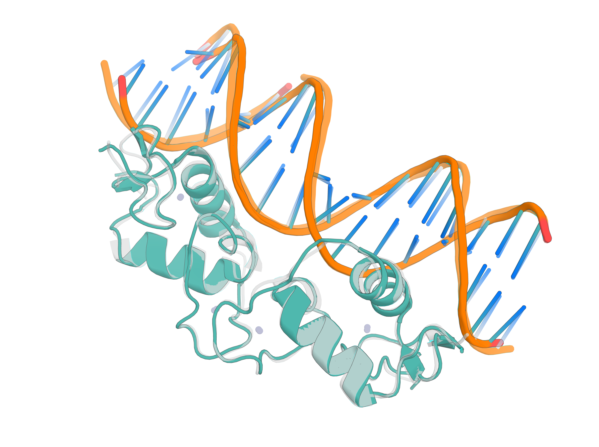

# Inference with RF3 (CaGE release)

<div align="center">
  
</div>

RF3 is an all-atom biomolecular structure prediction network, with implicit chirality
representations and atom-level geometric conditioning added at train time. For the model
itself see its preprint, [Accelerating Biomolecular Modeling with AtomWorks and
RF3](https://doi.org/10.1101/2025.08.14.670328).

This guide covers preparing inputs and running inference. Run `rf3 fold` from the
**repository root**: the bundled inputs reference their components with
repository-relative paths, resolved against your working directory. The five CaGE design
conditions and per-axis classifier-free guidance are specified in
[docs/DESIGN_CONDITIONS.md](../../docs/DESIGN_CONDITIONS.md); the sections below give the
runnable form of each.

## Installation and a first prediction

Requirements, environment variables, optional external tools and GPU notes are in
**[docs/INSTALL.md](../../docs/INSTALL.md)**; what each checkpoint contains and which one
you need is in **[docs/WEIGHTS.md](../../docs/WEIGHTS.md)**. The short version:

```bash
uv venv --python 3.12 && source .venv/bin/activate
uv pip install -e ".[rf3]"          # drop the extra on CPU / macOS
foundry install run14_confhead      # the default ckpt_path
rf3 fold inputs='models/rf3/tests/data/5vht_from_json.json'
```

`ckpt_path` also accepts a path, for a checkpoint not installed under a registered name:

```bash
rf3 fold inputs='models/rf3/tests/data/5vht_from_json.json' ckpt_path='/path/to/rf3.ckpt'
```

> [!NOTE]
> For our inference API, we use [hydra](https://hydra.cc/docs/tutorials/basic/your_first_app/simple_cli/) to prepare arguments; the [Hydra documentation](https://hydra.cc/docs/advanced/override_grammar/basic/) describes the command-line override syntax that we use below. Note that Hydra syntax differes from typical CLI or `argparse` syntax in that we don't use `--arg value`, but instead `arg=value`. See below for examples.

> [!TIP]
> Rather than `rf3 fold`, you may also directly use `python models/rf3/src/rf3/inference.py inputs='models/rf3/tests/data/5vht_from_json.json'` to interface with the Hydra entrypoint. This approach may yield more informative error messages in some cases.

From the above command, you should see an output directory (named after the input) with a structure like:

```
5vht_from_json/
├── 5vht_from_json_confidences.json          # per-atom confidence data (pLDDT, PAE, PDE, etc.)
├── 5vht_from_json_model.cif                 # best-ranked model structure
├── 5vht_from_json_ranking_scores.csv        # ranking scores across all seeds/samples
├── 5vht_from_json_summary_confidences.json  # summary confidence metrics for the best model
├── seed-0_sample-0/
│   ├── 5vht_from_json_seed-0_sample-0_confidences.json
│   ├── 5vht_from_json_seed-0_sample-0_model.cif
│   └── 5vht_from_json_seed-0_sample-0_summary_confidences.json
├── seed-0_sample-1/
│   └── ...
└── ...
```

The top-level files correspond to the best-ranked sample. Each `seed-X_sample-Y/` subdirectory contains the model and confidences for that particular diffusion sample. The `summary_confidences.json` files contain metrics such as `ptm`, `iptm`, `ranking_score`, `overall_plddt`, chain-level pTM, and pairwise chain PAE/PDE. The `confidences.json` files contain per-atom and per-token confidence data (similar to AlphaFold's output format).

For this example, the pTM in the summary confidences should be `>0.8` (even without an MSA); if not, there may be something wrong with your setup.

## Common Scenarios

<details>
<summary><strong>Folding with an MSA</strong></summary>

RF3 supports `.a3m` and `.fasta` files as input MSA formats; `.a3m` is recommended. Pre-paired MSAs are not supported (pairing happens on the fly) and neither is on-the-fly MSA computation.

📝 **Example JSON configuration** (full example found at `docs/releases/rf3/examples/3en2_from_json_with_msa.json`):

```json
{
    "name": "example_with_msa",
    "components": [
        {
            "seq": "AINRLQLVATLVEREV(MSE)RYTPAGVPIVNCLLSYSGQA(MSE)EAQAARQVEFSIEALGAGK(MSE)ASVLDRIAPGTVLECVGFLARKHRSSKALVFHISGLEHHHHHH",
            "msa_path": "/path/to/msa.a3m",
            "chain_id": "A"
        }
    ]
}
```

🚀 **Run the example:**

```bash
rf3 fold inputs='docs/releases/rf3/examples/3en2_from_json_with_msa.json'
```

---

If performing inference from a prepared `.cif` file, MSAs can also be specified directly as a category within the raw CIF data.
We will automatically extract the correct MSA paths during parsing.

📝 **Example CIF header** (full example found at `docs/releases/rf3/examples/3en2_from_file.cif`):
```cif
data_3EN2
#
_msa_paths_by_chain_id.A   docs/releases/rf3/examples/msas/3en2_A.a3m.gz
_msa_paths_by_chain_id.B   docs/releases/rf3/examples/msas/3en2_A.a3m.gz
# 
```

🚀 **Run the example:**

```bash
rf3 fold inputs='docs/releases/rf3/examples/3en2_from_file.cif'
```

> [!TIP]
> Early stopping is **disabled by default in this release** (`early_stopping_plddt_threshold=0`), because conditioned design predictions legitimately have low pLDDT. If you set a positive threshold, a prediction the model judges hopeless after one recycle stops early and only writes a `summary_confidences.json`, which saves compute on erroneous inputs — but without an MSA, examples like the ones above are exactly the predictions it will discard.

> [!TIP]
> To ensure that a provided MSA is loaded correctly, you may use the `raise_if_missing_msa_for_protein_of_length_n` command-line argument. For example, `rf3 fold inputs='docs/releases/rf3/examples/3en2_from_json_with_msa.json' raise_if_missing_msa_for_protein_of_length_n=10` would raise an error if there were any proteins >=10 residues without compatible MSAs.

> [!TIP]
> For non-canonical amino acids, most MSA generation algorithms substitute `X` (unknown residue)! Ensure your MSAs adhere to this convention.

</details>

<details>
<summary><strong>Folding Many Inputs</strong></summary>

When running multiple predictions, you'll notice that the **startup cost** (importing libraries, loading models, initializing CUDA) often takes significantly longer than the actual prediction itself. This is especially problematic when running many individual `rf3 fold` commands in sequence.

💡 **Solution: Batch Processing**

Instead of running separate commands, you can process multiple inputs in a single command to amortize the startup cost. Multiple inputs can be provided in three ways:

1. **Within a single JSON file** - Define multiple examples in one configuration
2. **Via the CLI `inputs` argument** - Specify multiple files using Hydra list syntax  
3. **Via a folder of compatible inputs** - Process all CIF/PDB/JSON files in a directory

We will automatically distribute predictions across GPU's if running in a multi-GPU environment.

---

### 1️⃣ **Single JSON with Multiple Examples**

📝 **Example JSON configuration** (full example found at `docs/releases/rf3/examples/multiple_examples_from_json.json`)

```json
[
    {
        "name": "multiple_examples_from_json(1)",
        "components": [
            {
                "seq": "MNAKEIVVHALRLLENGDARGWCDLFHPEGVLEYPYPPPGYKTRFEGRETIWAHMRLFPEYMTIRFTDVQFYETADPDLAIGEFHGDGVHTVSGGKLAADYISVLRTRDGQILLYRLFFNPLRVLEPLGLEHHHHHH",
                "chain_id": "A"
            },
            {
                "smiles": "O=C1OCC(=C1)C5C4(C(O)CC3C(CCC2CC(O)CCC23C)C4(O)CC5)C"
            }
        ]
    },
    {
        "name": "multiple_examples_from_json(2)",
        "components": [
            {
                "seq": "GSGVSLGQALLILSVAALLGTTVEEAVKRALWLKTKLGVSLEQAARTLSVAAYLGTTVEEAVKRALKLKTKLGVSLEQALLILFAAAALGTTVEEAVKRALKLKTKLGVSLEQALLILWTAVELGTTVEEAVKRALKLKTKLGVSLGQAQAILVVAAELGTTVEEAVYRALKLKTKLGVSLGQALLILEVAAKLGTTVEEAVKRALKLTTKLG",
                "chain_id": "A"
            },
            {
                "ccd_code": "MG"
            }
        ]
    }
]
```

🚀 **Run the example:**

```bash
rf3 fold inputs='docs/releases/rf3/examples/multiple_examples_from_json.json'
```

---

### 2️⃣ **Multiple Files via CLI Arguments**

You can specify multiple files/directories using Hydra's list syntax:

```bash
rf3 fold inputs='[docs/releases/rf3/examples/3en2_from_file.cif, docs/releases/rf3/examples/7o1r_from_json.json]'
```

---

### 3️⃣ **Directory Processing**

Process all CIF/PDB/JSON files in a directory at once (we will distribute across GPU's if running within a multi-GPU environment):

```bash
rf3 fold inputs='docs/releases/rf3/examples'
```

> [!TIP]
> **Performance Tip**: For large batches, consider using `early_stopping_plddt_threshold=0.5` or lower to quickly filter out low-confidence predictions and save compute time on obviously incorrect structures.

> [!NOTE]
> All outputs will be saved in the same directory (or `out_dir` if specified), with filenames based on the `name` field in your JSON or the original input filenames.

</details>

<details>
<summary><strong>Folding with Arbitrary Biomolecules</strong></summary>
<a id="folding-with-arbitrary-biomolecules"></a>

Complex assemblies containing arbitrary biomolecules can be easily folded if prepared within a `.cif` or a `.pdb` file that adheres to RCSB conventions.

🚀 **Run an example from a prepared CIF file:**
```bash
rf3 fold inputs='docs/releases/rf3/examples/7o1r_from_json.json'
```

Such files (including all bonds, covalent modifications, non-canonical amino acids, etc.) can be created either (a) directly from ProteinMPNN/LigandMPNN or other software that generates structural files; or, (b) assembled with [AtomWorks](https://github.com/RosettaCommons/atomworks) or another CIF-processing library.

For convenience, we also support a `json` API analogous to that implemented by AF3. We omit covalent modifications below as those are described in a subsequent example.

> [!TIP]
> **Performance Tip**: For small molecules, a general rule-of-thumb is that performance is best when using `CCD` codes directly, followed by `cif`/`sdf` files, and finally SMILES.

📝 **Example JSON configuration with arbitrary biomolecules** (full example found at `docs/releases/rf3/examples/7o1r_from_json.json`):
```json
[
    {
        "name": "7o1r_from_json",
        "components": [
            {
                "seq": "MKSLSFSLALGFGSTLVYSAPSPSSGWQAPGPNDVRAPCPMLNTLANHGFLPHDGKGITVNKTIDALGSALNIDANLSTLLFGFAATTNPQPNATFFDLDHLSRHNILEHDASLSRQDSYFGPADVFNEAVFNQTKSFWTGDIIDVQMAANARIVRLLTSNLTNPEYSLSDLGSAFSIGESAAYIGILGDKKSATVPKSWVEYLFENERLPYELGFKRPNDPFTTDDLGDLSTQIINAQHFPQSPGKVEKRGDTRCPYGYH",
                "msa_path": "docs/releases/rf3/examples/msas/7o1r_A.a3m.gz",
                "chain_id": "A"
            },
            {
                // A single free-floating magnesium ion
                // We will use atom names from the CCD
                // If no `chain_id` is specified, we will deterministically generate one (e.g., "B", since "A" exists above)
                // If your ligand is in the CCD, this format is preferred
                "ccd_code": "MG"
            },
            {
                // We provide the heme (HEME) via SDF from the CCD; we could have also used a CIF file
                // We will automatically name the atoms (SDF files do not specify atom names)
                "path": "docs/releases/rf3/examples/ligands/HEM.sdf"
            },
            {
                // We provide the imidazole ring (IMD) via SMILES
                // We will automatically name the atoms
                "smiles": "[nH]1cc[nH+]c1"
            },
        ],
    }
]
```

🚀 **Run the example:**

```bash
rf3 fold inputs='docs/releases/rf3/examples/7o1r_from_json.json'
```

**Supported input options:**

- **`seq`**: For proteins and nucleic acids using non-canonical one-letter codes as they appear in a CIF file. For example, `MTG(PTM)...` would suffice to include a phosphotyrosine.
- **`smiles`**: For small molecules (ensure correctness of SMILES, and proper indication of chirality when applicable)
- **`ccd_code`**: If your small molecule is already in the CCD
- **`path`**: If you have a `.sdf`, `.cif` or `.pdb` file (including `.cif` files for small
  molecules), optionally gzipped; `.bcif` also works. Note that `.mmcif` is *not* accepted
  here. A `.pdb` ligand keeps its `CONECT` connectivity but loses bond orders, so prefer
  `.sdf` or `.cif` for anything conjugated.

</details>

<details>
<summary><strong>Folding with a Covalent Modification</strong></summary>

RF3 supports both standard (e.g., in the CCD) covalent modifications and custom (e.g., not in the CCD) covalent modifications.

As described in the **Folding with Arbitrary Biomolecules** scenario above, a well-formed CIF file includes `struct_conn` records that detail covalent modifications. RF3 can natively handle such an input.

For example, folding `7o1r`, which contains two N-glycosylations:
```bash
rf3 fold inputs='docs/releases/rf3/examples/7o1r_from_json.json'
```


Such `.cif` files complete with appropriate bonds can be composed with AtomWorks.

If you would prefer to use the JSON API, bonds can be explicitly given using PyMol-like strings of the form `chain_id/res_name/res_id/atom_name`. You will need to know the specific chain ID, residue name, residue ID, and atom name between the relevant pairs of atoms to unambiguously specify the bond.

📝 **Example JSON configuration with covalent modifcations** (full example found at `docs/releases/rf3/examples/7o1r_from_json.json`):
```json
[
    {
        "name": "7o1r_from_json_with_covalent_modification",
        "components": [
            {
                "seq": "MKSLSFSLALGFGSTLVYSAPSPSSGWQAPGPNDVRAPCPMLNTLANHGFLPHDGKGITVNKTIDALGSALNIDANLSTLLFGFAATTNPQPNATFFDLDHLSRHNILEHDASLSRQDSYFGPADVFNEAVFNQTKSFWTGDIIDVQMAANARIVRLLTSNLTNPEYSLSDLGSAFSIGESAAYIGILGDKKSATVPKSWVEYLFENERLPYELGFKRPNDPFTTDDLGDLSTQIINAQHFPQSPGKVEKRGDTRCPYGYH",
                "msa_path": "docs/releases/rf3/examples/msas/7o1r_A.a3m.gz",
                "chain_id": "A"
            },
            {
                "ccd_code": "MG"
            },
            {
                // We provide one sugar via a CIF file, with complete control over bonds and atom names (as we use the atom names from the CIF file)
                "path": "docs/releases/rf3/examples/ligands/NAG.cif"
            },
            {
                "path": "docs/releases/rf3/examples/ligands/HEM.sdf"
            },
            {
                "smiles": "[nH]1cc[nH+]c1"
            },
            {
                // We provide another sugar via the CCD, using the canonical atom names
                "ccd_code": "NAG",
                "chain_id": "F"
            }
        ],
        "bonds": [
            // We can directly target C1 on the CCD example
            ["A/ASN/133/ND2", "F/NAG/1/C1"], 
            // Things are trickier for the custom CIF example. 
            // We must determine the atom name of the atom participating in the bond, and also specify the residue name and residue index
            // `L:0`, `L:1`, etc. are guaranteed non-conflicting residue names to give custom small molecules; we will automatically name custom small molecules in this fashion if different residue names are not specified
            // If a provided residue name exists in the CCD, during parsing we will load that CCD, which will typically lead to processing errors (e.g., if atom names don't match)
            // Note as well that the provided in this example CIF is 0-indexed for the residue index, whereas in the CCD above it is 1-indexed
            ["A/ASN/161/ND2", "C/L:0/0/C1"] 
        ]
    }
]
```
</details>

<details>
<summary><strong>Creating Custom CIF Files from SDF/SMILES with AtomWorks</strong></summary>

For some more convoluted applications it is necessary to provide custom CIF files. For example, if one wants to include a bespoke covalent modification. In such situations, generally the easiest path is to use AtomWorks to create and validate the file beforehand.

For example, in the covalent modifcation example above, the custom `NAG` `.cif` file was created with:

```python
from atomworks.io.utils.io_utils import read_any, to_cif_file
from atomworks.io.tools.rdkit import atom_array_from_rdkit, sdf_to_rdkit
from atomworks.io.utils.visualize import view
import numpy as np

# Load an SDF file into an AtomArray
sdf_path = "docs/releases/rf3/examples/ligands/NAG.sdf"

# Load into an AtomArray
# Since SDF file files do not have atom names, we automatically generate them (e.g., C1, C2, C3, etc.)
atom_array = atom_array_from_rdkit(sdf_to_rdkit(sdf_path))

# Alternatively, you can use smiles_to_rdkit followed by atom_array_from_rdkit if you have a SMILES string rather than an SDF file
# e.g., atom_array = atom_array_from_rdkit(smiles_to_rdkit("[nH]1cc[nH+]c1"))

# Ensure it looks correct and determine the correct atom name for the covalent bond
# You can hover over an atom in PyMol (or in using the `view` function as shown below) to display the atom name
# Based on this view, we can see that the atom name for the covalent bond is C1 (the attached oxygen will leave after bond formation)
view(atom_array)

# If we want to, we can rename residues, adjust charges, add bonds, etc.
atom_array.chain_id = np.full(len(atom_array), "D")
# WARNING: Ensure that the provided residue name is not in the CCD! Otherwise, we will try and load it from the CCD and almost certainly fail!
atom_array.res_name = np.full(len(atom_array), "NAG_2") 

# ... and save to a new file
to_cif_file(atom_array, "NAG.cif")
```

Similarly, for SMILES:

```python
# For a SMILES string
smiles = "[nH]1cc[nH+]c1"  # imidazole ring
atom_array = atom_array_from_rdkit(smiles_to_rdkit(smiles))

# Customize and save
atom_array.chain_id = np.full(len(atom_array), "E")
atom_array.res_name = np.full(len(atom_array), "IMD_CUSTOM")
to_cif_file(atom_array, "imidazole_custom.cif")
```

We now know exactly which atom name corresponds to which atom, enabling us to unambiguously specify bonds as needed.

> [!TIP]
> **Leaving Groups**: If your covalent modification includes a functional group or atom that leaves upon bond formation, that group should be replaced with a `H` *a priori* or specified as a leaving atom in the CIF file using the RCSB's [leaving atom flag](https://www.iucr.org/__data/iucr/cifdic_html/2/mmcif_pdbx.dic/Ichem_comp_atom.pdbx_leaving_atom_flag.html).

</details>

<details>
<summary><strong>Folding while Templating</strong></summary> 

RF3 departs from prior structure prediction models by including explicit atomic-level, ground-truth templates during training. That is, with some probability, we show the model a portion of the **the actual ground-truth crystal structure** rather than a template identified through homology-based search like prior methods. We make this choice to maximize flexibility during inference, where we often want to fix portions of the structure while allowing other components to fold.

More specifically, we template in two ways:
- At the token-level, by providing a ground-truth distogram
- At the atom-level through the reference-conformer track, where we provide an explicit "ground truth conformer"

Different templating techniques are appropriate for different situations. Templating polymer structure is best accomplished through the token-level track (`template_selection`). Small molecule templating (but only if we want to template the entire residue) is best accomplished through the `ground_truth_conformer_selection` track, but could also be done through `template_selection` in cases where we do not want to fix the entire residue.

We work through several examples below.

For our selection strings, we use the `AtomSelection` syntax from AtomWorks.

<details>
<summary><strong>AtomSelection Query Syntax</strong></summary>

RF3 uses AtomWorks' flexible `AtomSelectionStack` query syntax for specifying structural selections. The syntax follows the pattern `CHAIN/RES_NAME/RES_ID/ATOM_NAME/TRANSFORM_ID`, where each field can be:

- **Exact value**: `A`, `ALA`, `1`, `CA`, `0`
- **Wildcard**: `*` (matches any value)
- **Range** (residues only): `5-10` (inclusive range)
- **Multiple selections**: Comma-separated for union operations

#### Selection Grammar

| Field Position | Description | Examples |
|---|---|---|
| 1. Chain ID | Chain identifier | `A`, `B`, `*` |
| 2. Residue Name | 3-letter residue code | `ALA`, `GLY`, `*` |
| 3. Residue ID | Residue number (supports ranges) | `1`, `5-10`, `*` |
| 4. Atom Name | Atom identifier | `CA`, `CB`, `*` |
| 5. Transform ID | Transformation identifier | `0`, `1`, `*` |

Chain IDs and residue numbers are those of the **parsed** structure, which follow the
file's `label_*` fields rather than the author numbering a PDB entry quotes — in the
bundled `9dfn.cif`, author residue 38 is `ASN` while selected residue 38 is `CYS`. See
[docs/DESIGN_CONDITIONS.md](../../docs/DESIGN_CONDITIONS.md) ("Checking that a selection
matched") before copying numbers out of a paper.

#### Common Selection Examples

| Selection Description | Query Syntax |
|---|---|
| All atoms in chain A | `A` |
| All alanine residues in chain A | `A/ALA` |
| Residues 5-10 in chain A | `A/*/5-10` |
| CA atoms of residues 1-5 in chain B | `B/*/1-5/CA` |
| All atoms in chains A and B | `A, B` |
| Framework regions (CDR templating) | `B/*/1-42, B/*/49-63, B/*/71-102` |
| Specific atom in specific residue | `A/ALA/15/CB` |
| All backbone atoms in chain A | `A/*/*/N, A/*/*/CA, A/*/*/C, A/*/*/O` |
</details>


#### Templating a Polymer (Protein / DNA / RNA)

It is often helpful to template one or multiple polymer chains while allowing the other chain(s) to fold unconstrained. We demonstrate with an nanobody-antigen use case below how to apply templates.

📝 **Example JSON configuration templating the antigen and the nanobody framework** (full example found at `docs/releases/rf3/examples/7xli_template_antigen_and_framework.json`):
```json
[
    {
        "name": "7xli_template_antigen",
        "components": [
            {
                "path": "docs/releases/rf3/examples/templates/7xli_chain_A.cif"
            },
            {
                "path": "docs/releases/rf3/examples/templates/7xli_chain_B.cif"
            }
        ],
        "template_selection": ["A", "B/*/1-42", "B/*/49-63", "B/*/71-102", "B/*/108-125"]
    }
]
```

🚀 **Run the example:**

```bash
rf3 fold inputs='docs/releases/rf3/examples/7xli_template_antigen_and_framework.json'
```

You may also specify templating directly via the CLI using `template_selection="[A, B/*/1-42, ...]"`.

> [!NOTE]
> **Pairwise Contact Support**: The model was also trained with pairwise atom-pair distances, which are exposed at inference through [`distance_template_selection`](#templating-atom-pair-distances-distance_template_selection) — at atom level rather than token level. Token-level contact specification is not exposed.

#### Templating a Small Molecule

We find that enforcing a particular small molecule conformation has various applications within fixed-ligand protein docking, enzyme activity filtering, and other biologically relevant tasks. RF3 natively enables encouraging a particular small molecule conformations via both the ground truth reference conformer track and the template selection track. 

For the moment, the ground truth conformer track is only effective if we want to template the *entire* small molecule. Partial templating of small molecules is still possible via the `template_selection` approach. We encourage exploration of both templating techniques to find what combination(s) are most effective for a given problem. Below we provide both, which represents the strongest possible conditioning.

📝 **Example JSON configuration templating a small molecule and the corresponding protein** (full example found at `docs/releases/rf3/examples/9dfn_template_ligand_and_protein.json`):
```json
[
    {
        "name": "9dfn_template_ligand_and_protein",
        "components": [
            {
                "path": "docs/releases/rf3/examples/9dfn.cif"
            }
        ],
        "template_selection": ["A", "C", "D"],
        "ground_truth_conformer_selection": ["C", "D"]

    }
]
```

> [!NOTE]
> We template the protein above to avoid providing an MSA

🚀 **Run the example:**

```bash
rf3 fold inputs='docs/releases/rf3/examples/9dfn_template_ligand_and_protein.json'
```

You may also specify the ground truth conformer selection directly via the CLI, e.g., using `ground_truth_conformer_selection="[E]"`

#### Templating Atom-Pair Distances (`distance_template_selection`)

An atom-level **2D distance condition**: you give groups of atoms and the model is
conditioned to reproduce the pairwise distances *within* each group — all `N·(N-1)/2` of
them, taken from the input coordinates unless you state them. Unlike the other template
tracks it is **chain-agnostic**, so a cross-chain distance is simply two atoms from
different chains placed in the same group. Three forms, which may be mixed in one list:

```json
// one group, distances from the input coordinates
"distance_template_selection": ["A/HIS/111/NE2", "A/HIS/45/ND1", "A/LYS/126/NZ"]

// explicit groups; `distance` (Å) applies to every pair in its group, or is omitted
"distance_template_selection": [
    {"atoms": ["A/HIS/111/NE2", "A/HIS/45/ND1", "A/LYS/126/NZ"]},
    {"atoms": ["A/HIS/111/NE2", "B/GLU/20/OE1"], "distance": 3.0}
]

// an N×N matrix, setting every pair individually (each selection must match one atom)
"distance_template_selection": [
    {"atoms": ["A/*/48/CB", "A/*/48/CG", "A/*/52/OD1"],
     "distance": [[0.0, 1.5, 5.8], [1.5, 0.0, 4.6], [5.8, 4.6, 0.0]]}
]
```

To fix only the *relative* position of two motifs rather than their internal geometry, put
one representative atom from each motif together in a group.

> [!IMPORTANT]
> **Selected residues are atomized whole, and this changes the tokenization of the whole
> run.** Without it the trunk averages the distances token-wise and the side-chain-level
> information the condition carries is erased. Expect more tokens, more memory and a
> different token layout in the outputs than for the same input without the condition.

```bash
# explicit 4x4 distance matrix (6 conditioned pairs)
rf3 fold inputs='docs/releases/rf3/examples/design_conditions/2D_distance/distval_matrix_9dfn.json'

# distances taken from the input coordinates, combined with template_selection
rf3 fold inputs='docs/releases/rf3/examples/design_conditions/motif/motif_template_9dfn.json'
```

[docs/DESIGN_CONDITIONS.md](../../docs/DESIGN_CONDITIONS.md) covers the rest: the CLI
form, why atomization has to happen while the input is constructed, which pairs carry no
information at all, and how a JSON input differs from a CIF one over hydrogens.

#### Templating an Interface (`relative_template_selection`)

RF3 was also trained to respect interface templates — distances between tokens *across* an interface — and the CaGE release exposes that capability through `relative_template_selection`. Unlike `template_selection`, which fixes geometry *within* what it selects, this conditions the distances *between* the components of a group, leaving each component's internal geometry free.

It takes a `{group_name: [selections]}` mapping (a flat list is treated as a single group), and writes one annotation per group:

```json
[
    {
        "name": "relative_template_7xli",
        "components": [
            {"chain_id": "A", "path": "docs/releases/rf3/examples/templates/7xli_chain_A.cif"},
            {"chain_id": "B", "path": "docs/releases/rf3/examples/templates/7xli_chain_B.cif"}
        ],
        "relative_template_selection": {"epitope": ["A/*/88", "A/*/90", "A/*/164", "A/*/167", "B/*/64", "B/*/106", "B/*/108"]}
    }
]
```

🚀 **Run the example:**

```bash
rf3 fold inputs='docs/releases/rf3/examples/design_conditions/relative_template/relative_template_7xli.json'
```

> [!NOTE]
> This is a **new inference interface onto a condition RF3 already trained**, not a new condition: it reuses the inter-molecule distance conditioning the network was trained with, and CaGE adds the selection API and the CFG axis. Unlike `distance_template_selection`, it is chain-aware — it conditions distances between different components of a group, not within a chain.

</details>

## Design Conditions (CaGE)

Beyond templating, the CaGE weights were trained with **five atom-level design
conditions**, each requested with a selection in the same AtomWorks
[`AtomSelection` syntax](#selection-grammar) used for templating, either in the input JSON
or on the command line. They are conditions, not constraints: the model was trained to
respect them, and nothing enforces them at inference time.

| Condition | Field | Value |
|---|---|---|
| Interface hotspots | `hotspot_selection` | selection, or list of selections |
| Interface type | `interface_type` | `PPI` / `PLI` / `PNA`, or `{selection: label}` |
| Relative solvent accessibility | `rasa_selection` | list of selections (auto-binned), or `{selection: label}` |
| H-bond donor / acceptor | `hbond_selection` | `{selection: label}` only |
| Atom-pair distances | `distance_template_selection` | see [Templating Atom-Pair Distances](#templating-atom-pair-distances-distance_template_selection) |

[docs/DESIGN_CONDITIONS.md](../../docs/DESIGN_CONDITIONS.md) is the reference: the feature
and shape each condition writes, how often it was seen in training, the metric that scores
it, and the semantics that are easy to get wrong — the RASA label being accessibility
*within the selected atom set* rather than burial in the complex, `interface_type` being a
dependent axis under per-condition CFG, `BOTH` and protein-side RASA being out of
distribution, ions having no `ProtOr` radii. What follows is only the runnable form of
each; the examples are indexed with their verified featurization counts in
[docs/releases/rf3/examples/design_conditions/](../../docs/releases/rf3/examples/design_conditions/README.md).

### Interface hotspots (`hotspot_selection`)

Marks the atoms the designed partner is expected to contact. Hotspots were sampled on the
**target** side of an interface during training — the side that is given, while the
partner is generated — so put them on the chain you template, not the chain you want
designed.

```json
"hotspot_selection": ["A/*/88", "A/*/90", "A/*/164", "A/*/167"],
"interface_type": "PPI",
"template_selection": ["A"]
```

```bash
rf3 fold inputs='docs/releases/rf3/examples/design_conditions/hotspot/ppi_hotspot_7xli.json'
```

### Interface type (`interface_type`)

`PPI`, `PLI` or `PNA`, upper-case (`PNA` covers both DNA and RNA). A bare string is written
**only** onto the atoms `hotspot_selection` picks, so it does nothing without one; the
dict form writes onto its own selections and therefore stands alone.

```json
"interface_type": "PLI"
"interface_type": {"A/*/38": "PLI", "A/*/45": "PLI"}
```

```bash
rf3 fold inputs='docs/releases/rf3/examples/design_conditions/interface_type/pli_interface_type_9dfn.json'
rf3 fold inputs='docs/releases/rf3/examples/design_conditions/interface_type/pli_interface_type_dict_9dfn.json'
```

### Relative solvent accessibility (`rasa_selection`)

Asks for atoms to end up `BURIED` / `INTERMEDIATE` / `EXPOSED`, upper-case. Either
auto-binned from the input coordinates, or labelled explicitly:

```json
"rasa_selection": ["C/60C/101"]                 // auto: compute RASA and bin it
"rasa_selection": {"C/60C/101": "BURIED"}       // explicit label
```

```bash
rf3 fold inputs='docs/releases/rf3/examples/design_conditions/rasa/ligand_rasa_5hkn.json'
```

### H-bond donor / acceptor identity (`hbond_selection`)

Declares which atoms act as hydrogen-bond donors and which as acceptors. **Only the dict
form is accepted** — a list or a string raises `ValueError`, because deriving donors and
acceptors automatically needs the third-party HBPLUS program, which inference deliberately
does not call.

```json
"hbond_selection": {"C/SAM/402": "ACCEPTOR", "A/*/110": "DONOR"}
```

```bash
rf3 fold inputs='docs/releases/rf3/examples/design_conditions/hbond/explicit_hbond_9dfn.json'
```

### Atom-pair distances (`distance_template_selection`)

Documented with the templating tracks, above:
[Templating Atom-Pair Distances](#templating-atom-pair-distances-distance_template_selection).
It **atomizes the residues it selects**, which changes the tokenization of the whole run.

## Classifier-Free Guidance

Guidance amplifies the effect of a condition by contrasting a conditioned trunk pass
against an unconditioned one. It is **off by default**, and with it off a run behaves
exactly like a plain conditional run. The eight guidable axes are the five design
conditions — `hotspot`, `interface_type`, `rasa`, `hbond`, `distance_template` — plus
RF3's own `template`, `relative_template` and `ground_truth_conformer` tracks.

```bash
# guide one axis in isolation (a dict scale makes the main stream unconditional)
rf3 fold inputs='docs/releases/rf3/examples/design_conditions/2D_distance/distval_matrix_9dfn.json' \
  inference_classifier_free_guidance=true \
  'inference_cfg_scale={distance_template: 3.0}'

# guide everything the input selects, as one stream
rf3 fold inputs='...' inference_classifier_free_guidance=true inference_cfg_scale=2.0

# score each guidance stream separately, and rank by the merged one
rf3 fold inputs='...' \
  inference_classifier_free_guidance=true 'inference_cfg_scale={hotspot: 2.0}' \
  'confidence_streams=[main, conditions, merged]' ranking_stream=merged
```

[docs/DESIGN_CONDITIONS.md](../../docs/DESIGN_CONDITIONS.md) specifies the rest: how a
float scale differs from a dict and what the dict drops, what
`delta_uncond + s * (delta_named - delta_uncond)` makes of `s = 0` and `s = 1`,
noise-interval gating with `inference_cfg_sigma_min` / `_max`, which trunk representation
each confidence stream scores and which output file it lands in, and how `ranking_stream`
falls back. Defaults for every key are under
[Command-Line Arguments](#command-line-arguments) below.

## Chirality

If inputs are given in a form that specifies chirality, the model will receive the corresponding features and attempt to preserve the chirality of the inputs.

**Chiral formats include:**
- SMILES strings (e.g., using `@`)
- CIF, PDB, or SDF files with non-zero coordinates

## Command-Line Arguments

<details>
<summary><strong>Basic Arguments</strong></summary>

- **`inputs`** *(required)*: Path to a file (CIF/PDB/JSON) or list of files for prediction; if given a directory, all CIF/PDB files in that directory will be predicted. To specify a list of files/directories, use Hydra's list grammar: `foo="[path_1.cif, path_2.json, path_3.pdb]"`

- **`inference_engine`** *(required)*: The inference configuration to use. `rf3` is the only one in this release, and `rf3 fold` selects it by default.

- **`ckpt_path`** *(optional)*: Path to a checkpoint file, or the name of a registered checkpoint (`run14`, `run14_confhead`). Defaults to `run14_confhead`; registered names are resolved against `~/.foundry/checkpoints` and `FOUNDRY_CHECKPOINT_DIRS`.

- **`skip_existing`** *(optional)*: Whether to skip predictions where appropriately-named output structures already exist in the `out_dir`. Defaults to False (do not skip; overwrite instead).

- **`num_nodes`** *(optional)*: Number of nodes for distributed inference. Defaults to 1.

- **`devices_per_node`** *(optional)*: Number of devices (GPUs) per node. Defaults to 1.

- **`verbose`** *(optional)*: Whether to show detailed logging and print config trees. Also available as the `-v` / `--verbose` CLI flag. Defaults to False.

</details>

<details>
<summary><strong>Model Control Arguments</strong></summary>

- **`early_stopping_plddt_threshold`** *(optional)*: The average all-atom pLDDT value estimated after a single recycle that will trigger early-exit for that prediction. **Defaults to `0` in this release** (early stopping disabled): conditioned design predictions legitimately have low pLDDT (~0.3), so any positive threshold would discard them. Set it to e.g. `0.5` for ordinary structure-prediction batches, where it can **significantly** increase throughput (10-20x). If we early exit:
    - There will be no output structure files (`.cif`)
    - The `summary_confidences.json` file will contain a field `early_stopped` that will have the value `True`; it will also contain columns indicating the value of the all-atom pLDDT after the first recycle and the threshold applied.

- **`n_recycles`** *(optional)*: Number of recycles within the trunk. Defaults to 10.

- **`diffusion_batch_size`** *(optional)*: Number of output structures in the ensemble, drawn from the same model seed and forward pass of the Pairformer. Defaults to 5.

- **`num_steps`** *(optional)*: Number of steps for sampling of the diffusion module. AlphaFold3 uses 200 steps, but we find that 50 steps is generally safe with no quality degradation and significant speed improvements. Defaults to 50.

- **`model_seeds`** *(optional)*: List of model seeds. Running inference with multiple model seeds is the best, and most expensive, way to generate output diversity. For example, `model_seeds="[42]"` for a single seed, or `model_seeds="[42, 123]"` for multi-seed inference. Defaults to `null` (no explicit seed reset before each model forward pass).

  **Set this argument explicitly for reproducible runs and scale sweeps.** A `"seed"`
  field in an input JSON, including `"seed": 0` in the glycosidase examples, is not
  read by the inference input parser. Pass `model_seeds='[0]'` on the command line,
  or `model_seeds=[0]` when constructing `RF3InferenceEngine` in Python. The list
  applies to all examples in the run. With `model_seeds=null`, featurization still
  internally seeds with 0, and the forward pass continues from the RNG state left
  by featurization; it does not reset to seed 0 as `model_seeds=[0]` does. An unset
  model seed is also labelled `seed-0` in output paths, so that label is not evidence
  that `model_seeds=[0]` was used. Keep the same explicit seed list and
  `diffusion_batch_size` across sweep settings, and
  record them with the command; fixing a seed does not guarantee bitwise-identical
  results across different hardware or software versions.

- **`template_noise_scale`** *(optional)*: Noise scale applied to template coordinates. Defaults to `1e-5`.

</details>

<details>
<summary><strong>Advanced Structural Control Arguments</strong></summary>

- **`ground_truth_conformer_selection`** *(optional)*: Selection syntax for residues that should use ground truth conformers instead of generated ones. Uses `AtomSelection` format; see [Selection Grammar](#selection-grammar) for the syntax. If None, no residues will use ground truth conformers. This is useful for keeping known ligand conformations while allowing the model to predict protein structure around them. For example, if chains `C` and `D` are two difficult ligands that are not predicted correctly unconditionally, we could run `rf3 fold ... ground_truth_conformer_selection="[C,D]"` to force a particular conformation (we would also need to provide these chains through a CIF, SDF, or MOL file)

- **`template_selection`** *(optional)*: Selection syntax to provide token-level templates (for both polymers and non-polymers). Uses `AtomSelection` format. Similar to traditional homology-style templates, but also can be applied to small molecules (less rigidly adhered to than the `ground_truth_conformer_selection` approach). See [Folding while Templating](#templating-a-polymer-protein--dna--rna) for more information.

- **`relative_template_selection`** *(optional)*: `{group_name: [selections]}` (a flat list becomes a single group). Conditions the distances **between** the components of each group while leaving their internal geometry free — the interface-template use case. See [Templating an Interface](#templating-an-interface-relative_template_selection).

- **`distance_template_selection`** *(optional)*: Atom groups whose pairwise distances are conditioned, taken from the input coordinates or given explicitly (scalar or `N x N` matrix, in Å). Chain-agnostic. **Atomizes the residues it selects, changing the tokenization of the run.** See [Templating Atom-Pair Distances](#templating-atom-pair-distances-distance_template_selection).

- **`cyclic_chains`** *(optional)*: List of strings of chain ids that should be cyclized. If given a cif, the model will automatically detect cyclization.

</details>

<details>
<summary><strong>Design Condition Arguments (CaGE)</strong></summary>

See [Design Conditions (CaGE)](#design-conditions-cage) for worked examples and
[docs/DESIGN_CONDITIONS.md](../../docs/DESIGN_CONDITIONS.md) for the full reference. All
default to `null` (condition not applied).

- **`hotspot_selection`** *(optional)*: Selection syntax (string or list) marking interface hotspot atoms — atoms the designed partner is expected to contact. Trained on the *given* side of an interface. E.g. `hotspot_selection="[A/*/88, A/*/90]"`.

- **`interface_type`** *(optional)*: `PPI`, `PLI` or `PNA` (upper-case, case-sensitive; `PNA` covers DNA and RNA), or a `{selection: label}` dict. A bare string is written only onto the atoms picked by `hotspot_selection`, so it needs one; the dict form writes onto its own selections and stands alone. Under per-condition CFG the `interface_type` stream keeps `hotspot_selection` alongside the label, and guiding a bare string without one raises rather than guiding nothing.

- **`rasa_selection`** *(optional)*: A list of selections, whose relative solvent accessibility is computed and binned automatically, or a `{selection: label}` dict with `BURIED` / `INTERMEDIATE` / `EXPOSED`. Bin edges 0.1 / 0.2. Trained on ligand atoms only; do not select ions or metals.

- **`hbond_selection`** *(optional)*: A `{selection: label}` dict with `DONOR` / `ACCEPTOR` / `BOTH` / `NONE`. Lists and strings raise — automatic donor/acceptor assignment needs third-party HBPLUS and is not wired into inference. `BOTH` is out of distribution.

</details>

<details>
<summary><strong>Guidance Arguments (CaGE)</strong></summary>

See [Classifier-Free Guidance](#classifier-free-guidance).

- **`inference_classifier_free_guidance`** *(optional)*: Whether to enable CFG. Defaults to False, in which case behaviour is identical to a plain conditional run.

- **`inference_cfg_scale`** *(optional)*: A float — one guidance stream carrying every condition the input selects, at this scale — or a dict keyed by axis name (`hotspot`, `interface_type`, `rasa`, `hbond`, `distance_template`, `template`, `relative_template`, `ground_truth_conformer`), one stream per axis at its own scale with the main stream unconditional: `'inference_cfg_scale={distance_template: 3.0}'`. `s = 1` is no extrapolation, `s = 0` is the axis' zero point. Defaults to `1.0`.

- **`inference_cfg_sigma_min`** / **`inference_cfg_sigma_max`** *(optional)*: Restrict guidance to diffusion steps whose noise level `t_hat` lies in `[sigma_min, sigma_max]`. Defaults `0.0` and `null` (+inf), i.e. guide every step.

- **`confidence_streams`** *(optional)*: Which trunk streams the confidence head scores: `main`, `conditions`, `merged`. Defaults to `[main]`. Anything beyond `main` requires a checkpoint with a confidence head; each stream is written to its own summary file and costs one extra confidence-head pass per diffusion sample (no extra trunk passes).

- **`ranking_stream`** *(optional)*: Which scored stream orders `{example_id}_ranking_scores.csv` and picks the model copied to the top level. Defaults to `merged`, falling back to `main` wherever that stream was not produced.

</details>

<details>
<summary><strong>Motif Guidance Arguments</strong></summary>

Motif guidance is **not** a design condition and **not** a CFG axis: it is an untrained
projection the sampler applies to `x0` after the CFG blend, so it cannot be named in
`inference_cfg_scale` and it does not change tokenization. See
[docs/DESIGN_CONDITIONS.md §10](../../docs/DESIGN_CONDITIONS.md) for the full reference,
including why every group needs **at least 3 non-collinear anchor atoms**.

- **`motif_guidance_selection`** *(optional)*: Groups of atoms to pull, each rigid-aligned independently (so inter-group relative pose is *not* constrained). A group is `{name, atoms, anchor}`, where `anchor` is a subset of `atoms` driving that group's Kabsch fit and defaults to all of them: `'motif_guidance_selection=[{name: site, atoms: [A/*/38, A/*/47], anchor: [A/CYS/38/SG, A/HIS/47/NE2, A/HIS/47/ND1]}, {name: cofactor, atoms: [B]}]'`. A flat list is accepted for compatibility but anchors only its 4-field selections. Defaults to `null`.

- **`motif_guidance_reference`** *(optional)*: Where the target coordinates come from. Defaults to `null`, the input's own coordinates. A path, or a list of `{path, chain_id}`, pulls toward a different structure — the only way to decouple guidance from whatever `template_selection` already conditions on.

- **`inference_motif_guidance`** *(optional)*: The explicit opt-in. Defaults to False; a selection alone never arms guidance, so an input carrying one still folds unguided. Enabling it without a selection raises.

- **`inference_motif_guidance_mu`** *(optional)*: Fraction of the motif-atom → aligned-target gap closed per inner step. Dimensionless — no noise-level weighting, no clipping. Defaults to `1.0`, which is an exact **hard snap**, not a soft pull; lower it to leave the denoiser room to relax neighbouring bonds. `0` is off (the gate still evaluates and still logs arming).

- **`inference_motif_guidance_inner_steps`** *(optional)*: Projection steps per diffusion step, the target refit each one, so the residual gap goes as `(1 - mu)^inner_steps`. Defaults to `1`; `0` is an exact no-op.

- **`inference_motif_guidance_rmsd_threshold`** *(optional)*: A diffusion sample arms once its own anchor RMSD (max over groups) falls below this, in Å, and stays armed. Arming is **per sample**, not per batch. Defaults to `5.0`.

- **`inference_motif_guidance_t_high`** / **`inference_motif_guidance_t_low`** *(optional)*: Inclusive window on the step fraction `t_norm`, which runs `1.0` (first step, high noise) → `~0.0` (last). Defaults `0.5` and `0.0`, leaving the noisier first half unguided; raise `t_low` to leave the final steps to the denoiser. Refused under partial diffusion, whose truncated schedule would renormalize `t_norm`.

</details>

<details>
<summary><strong>Output Control Arguments</strong></summary>

- **`out_dir`** *(optional)*: Where to save predicted structures. The output files will be named the same as the input structures, or use the `name` field in the specification, if present. If not specified, results are returned in memory and not saved to disk.

- **`dump_predictions`** *(optional)*: Whether to save outputs as CIF files (vs. only the confidence JSON files). Defaults to True.

- **`dump_trajectories`** *(optional)*: Whether to dump the denoising trajectories. Defaults to False. Writes `{seed-S_sample-I}/trajectory/` with the noisy `x_t` and the `x0` estimate of every diffusion step — plus the per-stream and guided `x0` under CFG — all aligned to the final prediction; `models/rf3/scripts/render_diffusion_trajectory.py` renders these. Trajectories are memory- and CPU-intensive to save to disk; we do not suggest dumping them except for a select few structures, if needed.

- **`annotate_b_factor_with_plddt`** *(optional)*: Whether to annotate atom-level pLDDT, overwriting the `b_factor` column in the CIF output (full name is `b_iso_or_equiv` in mmCIF files). Defaults to True.

- **`one_model_per_file`** *(optional)*: Whether to save each diffusion sample in a separate file. Defaults to False.

- **`compress_outputs`** *(optional)*: Whether to gzip output CIF files. Defaults to False.

- **`sharding_pattern`** *(optional)*: Sharding pattern for organizing output files. Defaults to `null`.

- **`keep_all`** *(optional)*: Whether to keep waters and crystallization aids when parsing input structures. Defaults to True.

  > [!NOTE]
  > Each diffusion sample is saved as a separate `.cif` file in its own `seed-X_sample-Y/` subdirectory. The best-ranked model is also copied to the top-level output directory.
</details>


## Viewing the Predicted Structure(s)

Use the following code to view the predicted structures with AtomWorks

```python
from atomworks.io.utils.visualize import view
from atomworks.io import parse

# View in atomworks (or PyMol, etc.)
out = parse("path/to/prediction.cif")
atom_array = out["assemblies"]["1"][0]
# (If in a notebook)
view(atom_array)
```

**Alternative viewing options:**
- View in PyMol like normal, or using `pymol_remote`
- Use the `view_pymol()` function for direct PyMol integration

